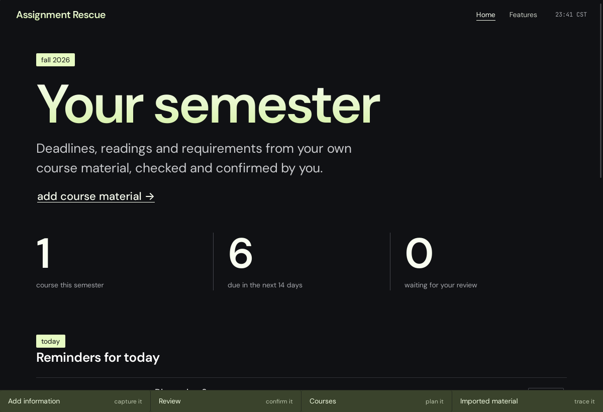
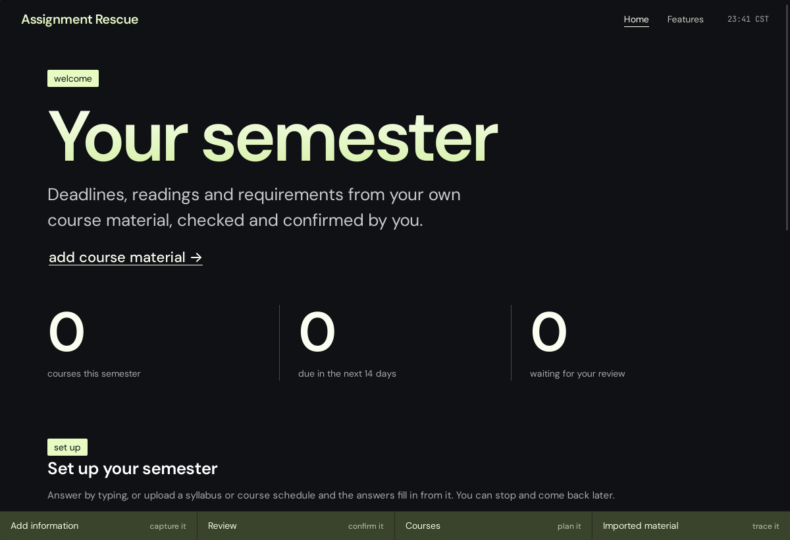
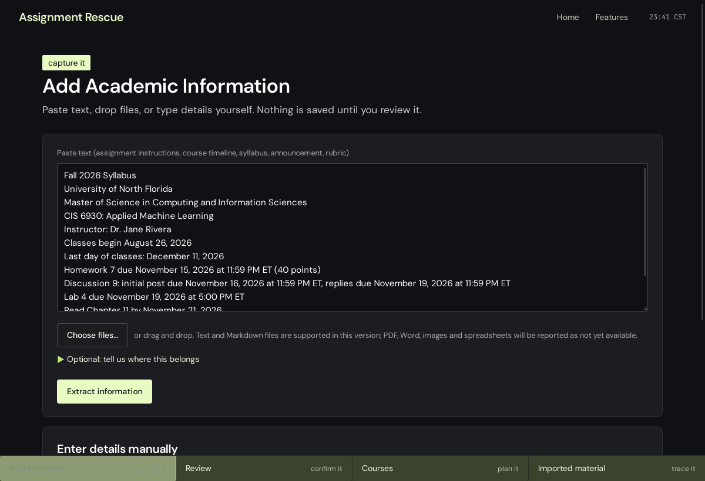
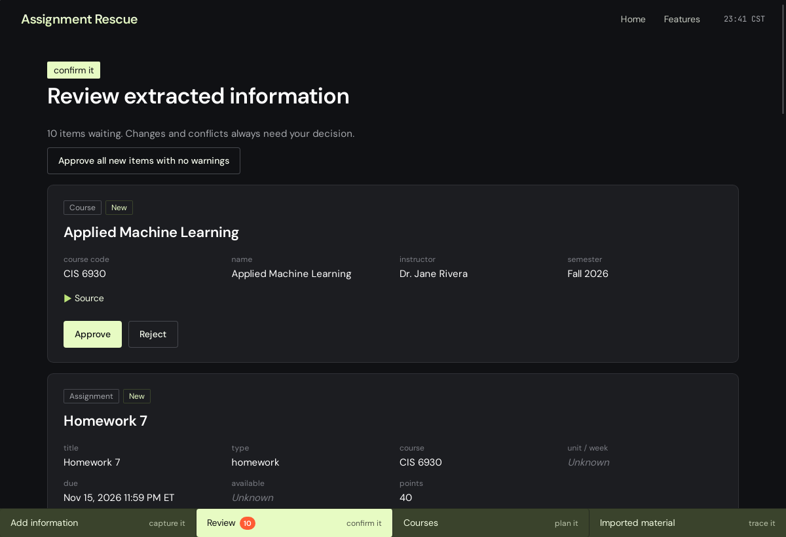
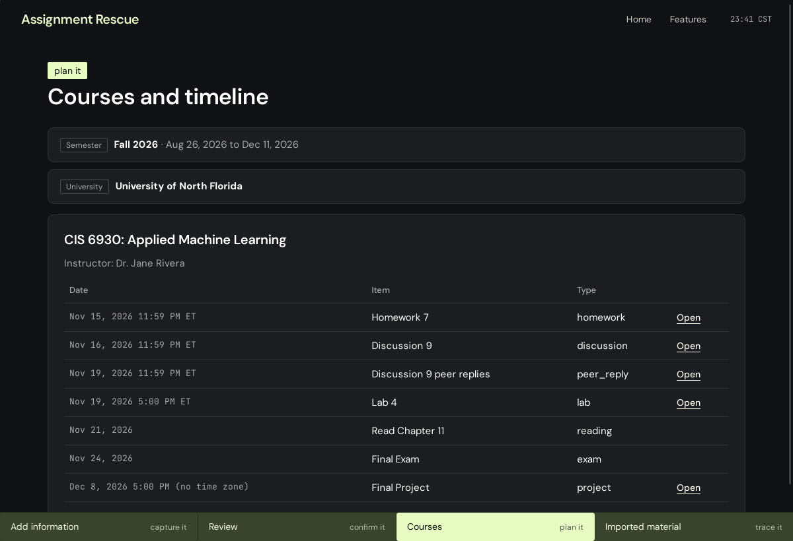
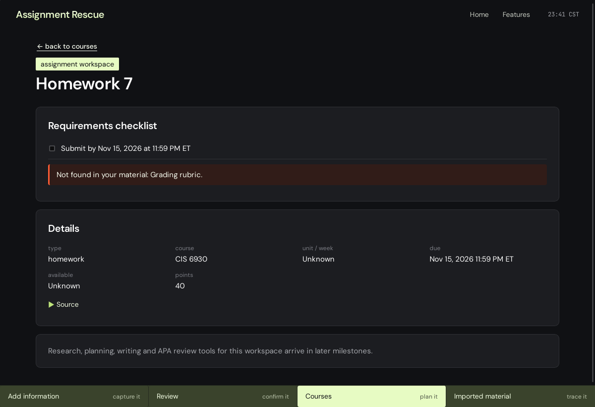
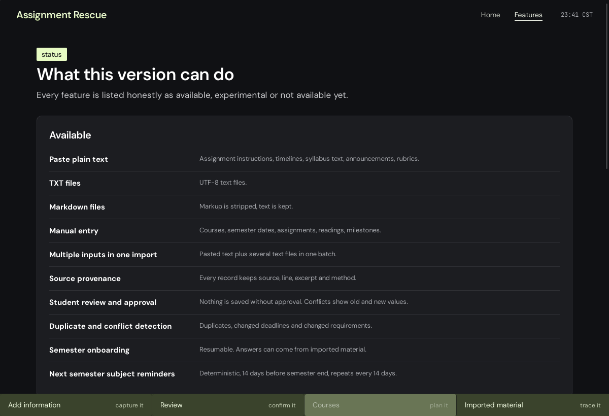

# Assignment Rescue AI

A local first desktop app for students on macOS and Windows. Paste a syllabus, a Canvas page, an assignment prompt or a rubric, and Assignment Rescue turns it into a confirmed academic timeline where every deadline traces back to the exact line it came from. Nothing is saved until you approve it, and nothing leaves your computer.

Built with Tauri 2, React, TypeScript and SQLite.



> **Where the project stands:** milestone 1 of 12 is done (plain text and manual entry, end to end). See [PROGRESS.md](PROGRESS.md) for the full status, what is verified, and what comes next.

---

## Contents

1. [What it does today](#what-it-does-today)
2. [Screenshots](#screenshots)
3. [Install and run](#install-and-run)
4. [Using the app](#using-the-app)
5. [Building installers](#building-installers)
6. [Testing](#testing)
7. [Project structure](#project-structure)
8. [Privacy and security](#privacy-and-security)
9. [Design](#design)
10. [Documentation](#documentation)

---

## What it does today

| Area | Status |
|---|---|
| Paste text, TXT and Markdown files, manual entry, several inputs in one import | ✅ Available |
| Format detection by file signature, with clear errors for unsupported, corrupt and empty files | ✅ Available |
| Semester onboarding: seven questions, answered by typing or straight from an imported syllabus, resumable | ✅ Available |
| Review screen: every extracted item needs approval, changed deadlines show old and new values side by side | ✅ Available |
| Source tracing: every record keeps the file, line, character span and excerpt it came from | ✅ Available |
| Duplicate and conflict detection across sources and against confirmed records | ✅ Available |
| Next semester subject reminders (14 days before the semester ends, every 14 days until answered) | ✅ Available |
| Assignment workspace with a requirements checklist and a list of missing information | ✅ Available |
| Content classification (16 labels) and entity extraction | 🧪 Experimental, rule based |
| Deadline reminders (7, 3, 1 and 0 days before) | 🧪 Experimental, shown while the app is open |
| PDF, Word, screenshots and OCR, CSV, Excel, JSON, calendar files | ⏳ Not available yet |
| Calendar views, notifications while closed, AI agents, research, writing, APA, originality, statistics | ⏳ Not available yet |

The app has its own **Features** screen that shows the same list, read from the same registry the tests check, so the app never claims more than it can do.

## Screenshots

| | |
|---|---|
| **First launch** — onboarding asks seven questions, and an imported syllabus can answer all of them | **Add information** — paste text or drop files; nothing is saved yet |
|  |  |
| **Review** — each item is approved or rejected; warnings such as a missing time zone are flagged | **Courses** — the confirmed timeline per course |
|  |  |
| **Assignment workspace** — requirements checklist and what is still missing | **Features** — what this version can and cannot do |
|  |  |

All screenshots come from the real desktop build, captured automatically by the end to end test with synthetic data.

## Install and run

### Prerequisites

| Tool | Version | Notes |
|---|---|---|
| Node.js | 20 or newer (22 recommended) | https://nodejs.org |
| Rust | stable | https://rustup.rs |
| Platform libraries | see below | Needed by Tauri |

**macOS:** install Xcode Command Line Tools.

```bash
xcode-select --install
```

**Windows:** install [Microsoft C++ Build Tools](https://visualstudio.microsoft.com/visual-cpp-build-tools/) with the "Desktop development with C++" workload. WebView2 is already included in Windows 10 (1803+) and Windows 11.

**Linux (for development only):**

```bash
sudo apt install libwebkit2gtk-4.1-dev libgtk-3-dev librsvg2-dev libayatana-appindicator3-dev build-essential
```

Full details: https://v2.tauri.app/start/prerequisites/

### Get the code and run it

```bash
git clone https://github.com/RevanthBharadwaj/AssignmentRescuer.git
cd AssignmentRescuer
npm install
npm run tauri dev
```

The first run compiles the Rust side and takes a few minutes. After that the app opens in its own window and reloads as you edit the code.

### Quick look in a browser (no Rust needed)

```bash
npm install
npm run dev
```

Open http://localhost:1420. The browser preview uses the same app with an in-browser copy of SQLite (sql.js). Data is kept in that browser only.

## Using the app

1. **Start at Home.** On first launch you see seven onboarding questions: university, program, semester, start date, end date, length and subjects.
2. **Add information** (bottom bar, "capture it"). Paste a syllabus, course schedule, announcement, assignment prompt or rubric, or choose TXT and Markdown files. You can also enter a course, semester, deadline, reading, milestone or exam by hand. Optional fields let you say which university, semester or course the material belongs to.
3. **Review** ("confirm it"). Every extracted item appears as a card. Approve it, reject it, or for a changed deadline choose the saved value or the new one. Open **Source** on any card to see the exact line it came from. "Approve all new items with no warnings" clears the simple ones in one click.
4. **Courses** ("plan it"). See each course's confirmed timeline in date order, and open any assignment to get its requirements checklist and a list of anything the material didn't say (for example the citation style or rubric).
5. **Imported material** ("trace it"). See every source you've imported, read its full text, or delete it. Deleting a source also removes records that came only from it.
6. **Next semester.** Fourteen days before the semester ends, Home asks which subjects you're taking next. Save them, ask again in 14 days, snooze for 3 days, say you're not enrolling, or turn the reminder off.

Tip: anything the parser can't find is shown as *Unknown* rather than guessed. A date written without a year stays flagged until a semester tells the app which year it is.

## Building installers

```bash
npm run tauri build
```

| Platform | Output |
|---|---|
| macOS | `src-tauri/target/release/bundle/dmg/*.dmg` and `.../macos/*.app` |
| Windows | `src-tauri/target/release/bundle/msi/*.msi` and `.../nsis/*-setup.exe` |

Build each platform on that platform. The GitHub Actions workflow in `.github/workflows/ci.yml` builds both on every push to `main` and uploads the installers as workflow artifacts. Installers are not code signed yet, so macOS Gatekeeper and Windows SmartScreen will warn on first open.

## Testing

```bash
npm run check                                       # type check, lint, all tests, production build
cargo test --manifest-path src-tauri/Cargo.toml     # Rust database layer
```

| Suite | What it covers |
|---|---|
| Vitest (82 tests) | Date parsing, classification, format detection, security, extraction, import pipeline, merging, database repository, transactions, reminders, onboarding, checklist, and React screens against a real SQLite database |
| Rust (3 tests) | Atomic batches, typed results, parameter validation |
| End to end | The real desktop build driven through WebDriver: first launch, paste, review, approve, restart, data still there |

Running the end to end test (Linux):

```bash
sudo apt install webkit2gtk-driver xvfb
cargo install tauri-driver --locked
npx tauri build --debug --no-bundle
tauri-driver &
SCREENSHOT_DIR=docs/screenshots xvfb-run -a node e2e/desktop.e2e.mjs src-tauri/target/debug/assignment-rescue-ai
```

See [docs/TESTING.md](docs/TESTING.md) for how the tests map to the specification.

## Project structure

```
src/
  core/                domain logic, no UI and no I/O
    input/             format detection and text extractors
    classify/          content classifier
    extract/           date parsing and entity extraction
    merge/             duplicate and conflict detection
    reminders/         next semester and deadline reminder scheduling
    assignments/       requirements checklist
    security/          untrusted input handling
    pipeline.ts        the import pipeline
    service.ts         application service used by the UI
    features.ts        what is implemented, experimental or unavailable
  db/                  SQLite schema, repository and drivers
  ui/                  React screens and styles
src-tauri/             desktop shell and the Rust SQLite layer
tests/                 unit, integration and UI tests with synthetic fixtures
e2e/                   WebDriver test of the real desktop build
docs/                  architecture, design, roadmap, testing, GitHub setup, screenshots
PROGRESS.md            where the project stands
```

## Privacy and security

Everything is stored in one SQLite file in your user app data folder, and this version makes no network or AI calls. Imported text is treated as data, never as instructions: hidden characters are stripped, and lines that look like attempts to instruct software (for example "ignore previous instructions") are flagged on the review screen. The desktop shell enables no HTTP, shell or file system plugins. The `.gitignore` blocks databases and common document formats so student material can't be committed by accident; the only documents in this repository are synthetic test fixtures.

## Design

The interface uses a dark studio look: a near black canvas, a lime cream accent, large tightly tracked DM Sans headlines, small square label chips, numbered steps, oversized numbers, and a segmented bottom bar for the four workflow stages (capture it, confirm it, plan it, trace it). Fonts are bundled with the app so it works offline. Design tokens and rationale are in [docs/DESIGN.md](docs/DESIGN.md).

## Documentation

| File | Contents |
|---|---|
| [PROGRESS.md](PROGRESS.md) | Milestone status, verification, next steps |
| [docs/ARCHITECTURE.md](docs/ARCHITECTURE.md) | Pipeline, data model, storage, matching, reminders, security |
| [docs/DESIGN.md](docs/DESIGN.md) | Visual language and design tokens |
| [docs/ROADMAP.md](docs/ROADMAP.md) | The 12 milestone plan and known limitations |
| [docs/TESTING.md](docs/TESTING.md) | Test suites and specification coverage |
| [docs/GITHUB_SETUP.md](docs/GITHUB_SETUP.md) | Pushing to a GitHub account |
| [docs/specs/universal-academic-input.md](docs/specs/universal-academic-input.md) | The feature specification |
