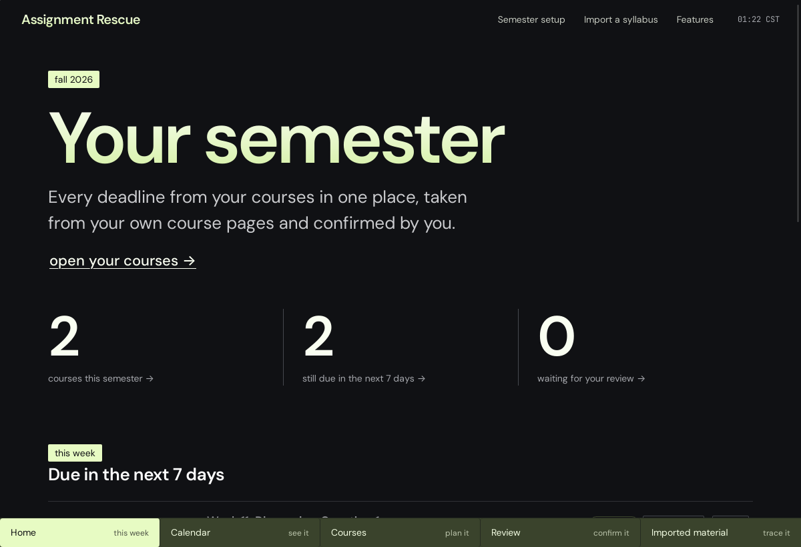
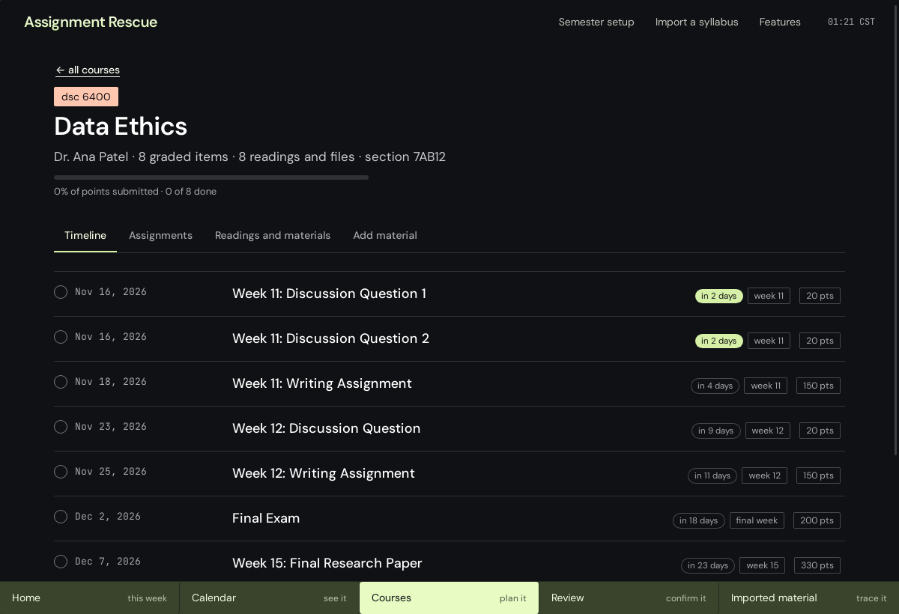
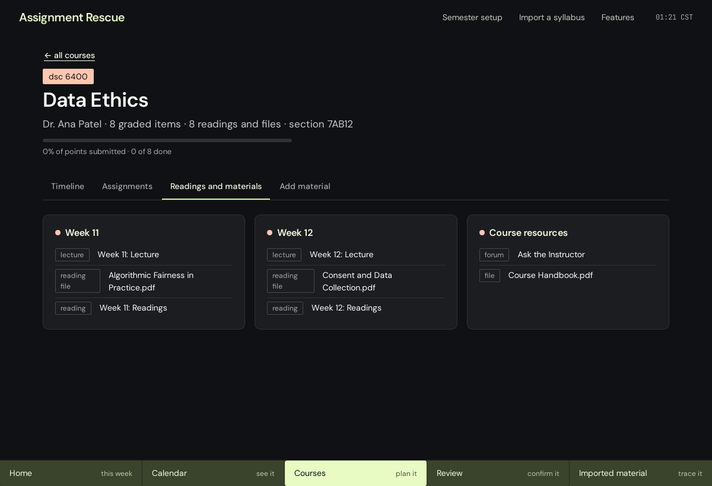
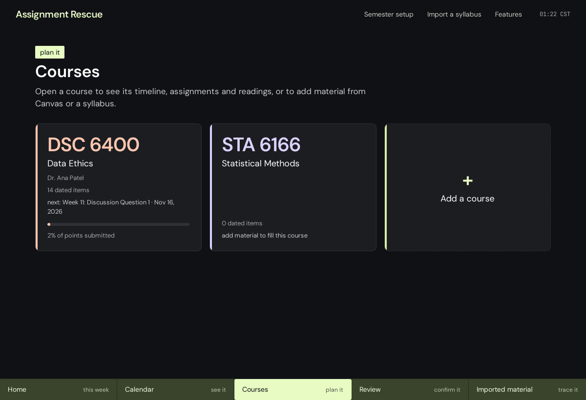
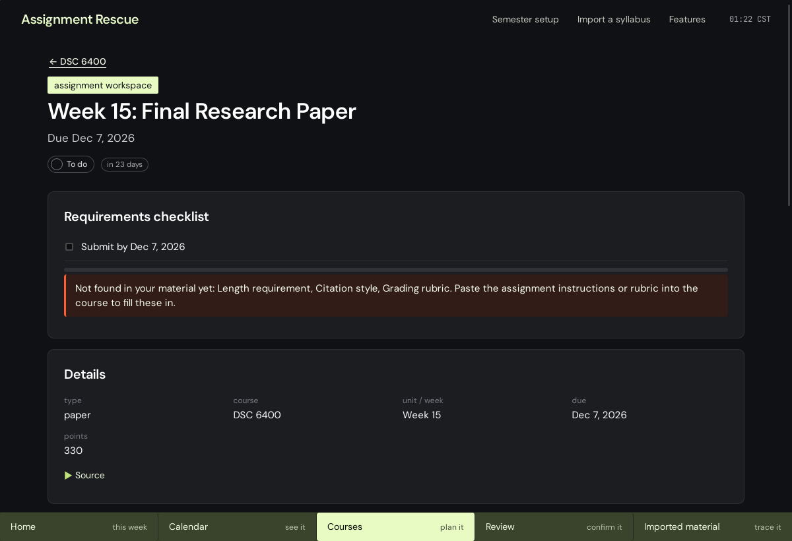
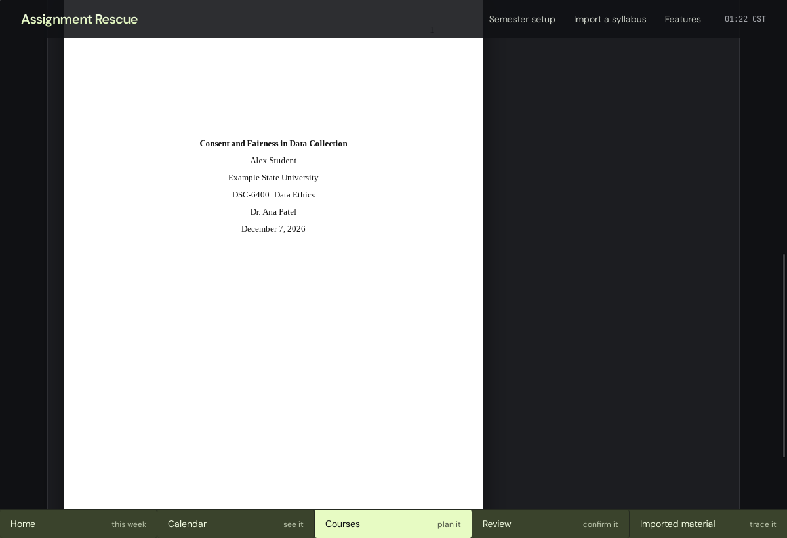

# Assignment Rescue AI

A local first desktop app for students on macOS and Windows. Paste a syllabus, a Canvas page, an assignment prompt or a rubric, and Assignment Rescue turns it into a confirmed academic timeline where every deadline traces back to the exact line it came from. Nothing is saved until you approve it, and nothing leaves your computer.

Built with Tauri 2, React, TypeScript and SQLite.



> **Where the project stands:** milestone 1 of 12 is done (text input end to end, including Canvas pages), with semester setup and course pages in place. See [PROGRESS.md](PROGRESS.md) for the full status, what is verified, and what comes next.

---

## Contents

1. [What it does today](#what-it-does-today)
2. [Screenshots](#screenshots)
3. [Install and run](#install-and-run)
4. [Using the app](#using-the-app)
5. [Building installers](#building-installers)
6. [Testing](#testing)
7. [Project structure](#project-structure)
8. [Privacy and security](#privacy-and-security)
9. [Design](#design)
10. [Documentation](#documentation)

---

## What it does today

You set up your semester once (school, semester dates, courses). Then, for each course, you open it in Canvas, copy the Modules page, and paste it into the course in the app. The app separates graded work from readings, lectures and files, reads every due date and point value, and shows you one list to approve. After that, Home shows what is due this week across all your courses, each course has its own timeline, and every assignment opens into a workspace with a requirements checklist.

| Area | Status |
|---|---|
| Semester setup with real fields: your name, school, program, term, first and last day, courses; saved sections become read only with a Modify button | ✅ Available |
| Canvas course list (Courses → All Courses) pasted into setup: codes, names, sections and term | ✅ Available |
| Course pages with Timeline, Assignments, Readings and materials, and Add material tabs | ✅ Available |
| Canvas Modules page pasted as text: items, due dates, points, units, readings, lectures, files, reminders | ✅ Available |
| PDF and Word (.docx) files: syllabi, schedules, assignment instructions, rubric tables; each item keeps its page | ✅ Available |
| Syllabus, assignment instructions, rubric, announcement pasted as text; TXT and Markdown files | ✅ Available |
| Calendar: month and week views, coloured by course, breaks and semester days marked, filter by course | ✅ Available |
| Mark work to do, in progress or submitted (with undo), course progress by points, urgency labels (due today, tomorrow, overdue) | ✅ Available |
| Drag and drop files onto a course | ✅ Available |
| Review inside each course: approve many items at once, type a date for anything that has none | ✅ Available |
| Changed deadlines and disagreeing sources shown side by side, nothing overwritten silently | ✅ Available |
| Source tracing: every item keeps the exact lines it came from | ✅ Available |
| Home: due in the next 7 days, the week after, and items still needing a date | ✅ Available |
| Assignment workspace with a requirements checklist and a list of missing information | ✅ Available |
| Title page in your paper format (APA 7 student), filled from setup and the course | 🧪 Experimental, preview and copy |
| Next semester subject reminders (14 days before the semester ends, every 14 days until answered) | ✅ Available |
| Content classification and extraction for free text | 🧪 Experimental, rule based |
| Deadline reminders (7, 3, 1 and 0 days before) | 🧪 Experimental, shown while the app is open |
| Scanned PDFs and screenshots (OCR), CSV, Excel, calendar files | ⏳ Not available yet (scans are detected and reported) |
| Notifications while closed, AI agents, research, writing, APA, originality, statistics | ⏳ Not available yet |

The app's own **Features** screen shows the same list, read from the registry the tests check, so it never claims more than it can do.

## Screenshots

| | |
|---|---|
| **Semester setup** — school, dates and courses, saved as you type them | **Review inside the course** — a pasted Canvas page becomes one checklist; items without a date get a date box |
|  |  |
| **Course timeline** — every graded item in date order with unit and points | **Readings and materials** — readings, lectures and PDFs grouped by week |
|  |  |
| **Courses** — one card per course with what is next | **Assignment workspace** — checklist and what is still missing |
|  |  |
| **Title page** — your paper format, filled from setup and the course | **Calendar** — month view coloured by course, with status and breaks |
|  |  |

All screenshots come from the real desktop build, captured automatically by the end to end test with synthetic course data.

## Install and run

### Prerequisites

| Tool | Version | Notes |
|---|---|---|
| Node.js | 20 or newer (22 recommended) | https://nodejs.org |
| Rust | stable | https://rustup.rs |
| Platform libraries | see below | Needed by Tauri |

**macOS:** install Xcode Command Line Tools.

```bash
xcode-select --install
```

**Windows:** install [Microsoft C++ Build Tools](https://visualstudio.microsoft.com/visual-cpp-build-tools/) with the "Desktop development with C++" workload. WebView2 is already included in Windows 10 (1803+) and Windows 11.

**Linux (for development only):**

```bash
sudo apt install libwebkit2gtk-4.1-dev libgtk-3-dev librsvg2-dev libayatana-appindicator3-dev build-essential
```

Full details: https://v2.tauri.app/start/prerequisites/

### Get the code and run it

```bash
git clone https://github.com/RevanthBharadwaj/AssignmentRescuer.git
cd AssignmentRescuer
npm install
npm run tauri dev
```

The first run compiles the Rust side and takes a few minutes. After that the app opens in its own window and reloads as you edit the code.

### Quick look in a browser (no Rust needed)

```bash
npm install
npm run dev
```

Open http://localhost:1420. The browser preview uses the same app with an in-browser copy of SQLite (sql.js). Data is kept in that browser only.

## Using the app

1. **Set up your semester.** On first launch Home sends you to **Semester setup** (top bar). Enter your name, university and program, pick the term and year, and set the first and last day of the semester. For courses, open **Courses → All Courses** in Canvas, copy the list and paste it into **Paste your course list**: codes, names, sections and the term are read for you. Use **Modify** on a course to add its instructor. Saved sections turn read only; press **Modify** to change them.
2. **Fill each course from Canvas.** Open **Courses** in the bottom bar and click a course, then the **Add material** tab. In Canvas, open that course's **Modules** page, press **Cmd+A** (Windows: **Ctrl+A**) and **Cmd+C**, then paste into the box and click **Extract**. Syllabus and assignment PDFs or Word files can be dropped onto the same card. Something you imported before is read again for the course you add it to.
3. **Approve.** Right below, everything found is listed in groups: graded work and deadlines, readings and files, reminders. Untick anything you don't want. Projects that the course page only mentions ("Project 2 is due next week") have a date box so you can type the date before approving. Click **Approve N selected**. Open **source** on any row to see the exact lines it came from.
4. **Use it.** The course's **Timeline** tab lists every graded item in date order, **Assignments** shows points and types, **Readings and materials** groups readings, lectures and PDFs by week. Click any assignment to open its workspace: the checklist, what is still missing, and a title page in your paper format (type the paper title once; name, university, course, instructor and date fill in).
5. **Check Home and Calendar.** Home shows what is due in the next 7 days across all courses, the week after, and anything still waiting for a date. **Calendar** shows the month or week, coloured by course; click a day for its list, click an item to open it, and click a course in the legend to hide it.
6. **Track your work.** The round button next to each item cycles **to do → in progress → submitted**; a toast lets you undo. Each course shows how much of its points you've submitted, and items carry urgency labels such as *tomorrow* or *2 days overdue*.
7. **Keep it current.** When an instructor changes a date, paste the updated page or announcement. The app shows the old and new date side by side under **Review** and only changes it if you approve.
8. **Next semester.** Fourteen days before the semester ends, Home asks which subjects you're taking next.

**Import a syllabus** (top bar) is for material that isn't tied to one course yet, such as a full program schedule. **Imported material** (bottom bar) lists everything you've pasted and lets you delete it.

## Building installers

```bash
npm run tauri build
```

| Platform | Output |
|---|---|
| macOS | `src-tauri/target/release/bundle/dmg/*.dmg` and `.../macos/*.app` |
| Windows | `src-tauri/target/release/bundle/msi/*.msi` and `.../nsis/*-setup.exe` |

Build each platform on that platform. The GitHub Actions workflow in `.github/workflows/ci.yml` builds both on every push to `main` and uploads the installers as workflow artifacts. Installers are not code signed yet, so macOS Gatekeeper and Windows SmartScreen will warn on first open.

## Testing

```bash
npm run check                                       # type check, lint, all tests, production build
cargo test --manifest-path src-tauri/Cargo.toml     # Rust database layer
```

| Suite | What it covers |
|---|---|
| Vitest (112 tests) | Date parsing, classification, Canvas module lists, PDF and Word extraction, format detection, security, extraction, import pipeline, merging, database repository, transactions, reminders, onboarding, checklist, and React screens (setup, course pages, review) against a real SQLite database |
| Rust (3 tests) | Atomic batches, typed results, parameter validation |
| End to end | The real desktop build driven through WebDriver: first launch, semester setup, pasting a Canvas page into a course, approving, restart, data still there, assignment workspace |

Running the end to end test (Linux):

```bash
sudo apt install webkit2gtk-driver xvfb
cargo install tauri-driver --locked
npx tauri build --debug --no-bundle
tauri-driver &
SCREENSHOT_DIR=docs/screenshots xvfb-run -a node e2e/desktop.e2e.mjs src-tauri/target/debug/assignment-rescue-ai
```

See [docs/TESTING.md](docs/TESTING.md) for how the tests map to the specification.

## Project structure

```
src/
  core/                domain logic, no UI and no I/O
    input/             format detection and text extractors
    classify/          content classifier
    extract/           date parsing, entity extraction, Canvas module lists (canvas.ts)
    merge/             duplicate and conflict detection
    reminders/         next semester and deadline reminder scheduling
    assignments/       requirements checklist
    security/          untrusted input handling
    pipeline.ts        the import pipeline
    service.ts         application service used by the UI
    features.ts        what is implemented, experimental or unavailable
  db/                  SQLite schema, repository and drivers
  ui/                  React screens and styles
src-tauri/             desktop shell and the Rust SQLite layer
tests/                 unit, integration and UI tests with synthetic fixtures
e2e/                   WebDriver test of the real desktop build
docs/                  architecture, design, roadmap, testing, GitHub setup, screenshots
PROGRESS.md            where the project stands
```

## Privacy and security

Everything is stored in one SQLite file in your user app data folder, and this version makes no network or AI calls. Imported text is treated as data, never as instructions: hidden characters are stripped, and lines that look like attempts to instruct software (for example "ignore previous instructions") are flagged on the review screen. The desktop shell enables no HTTP, shell or file system plugins. The `.gitignore` blocks databases and common document formats so student material can't be committed by accident; the only documents in this repository are synthetic test fixtures.

## Design

The interface uses a dark studio look: a near black canvas, a lime cream accent, large tightly tracked DM Sans headlines, small square label chips, numbered steps, oversized numbers, and a segmented bottom bar for the four main areas (Home, Courses, Review, Imported material). Fonts are bundled with the app so it works offline. Design tokens and rationale are in [docs/DESIGN.md](docs/DESIGN.md).

## Documentation

| File | Contents |
|---|---|
| [PROGRESS.md](PROGRESS.md) | Milestone status, verification, next steps |
| [docs/ARCHITECTURE.md](docs/ARCHITECTURE.md) | Pipeline, data model, storage, matching, reminders, security |
| [docs/DESIGN.md](docs/DESIGN.md) | Visual language and design tokens |
| [docs/ROADMAP.md](docs/ROADMAP.md) | The 12 milestone plan and known limitations |
| [docs/TESTING.md](docs/TESTING.md) | Test suites and specification coverage |
| [docs/GITHUB_SETUP.md](docs/GITHUB_SETUP.md) | Pushing to a GitHub account |
| [docs/specs/universal-academic-input.md](docs/specs/universal-academic-input.md) | The feature specification |
| [docs/specs/paper-format.md](docs/specs/paper-format.md) | The paper format the writing and export tools must produce |
